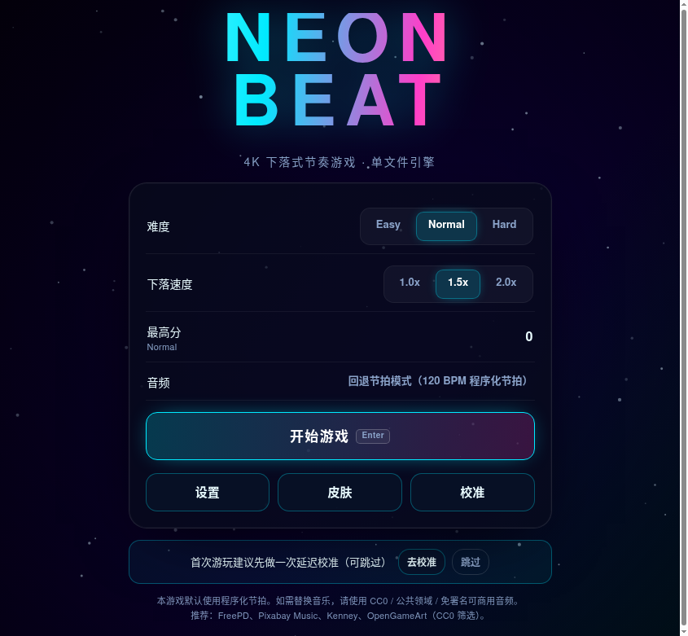
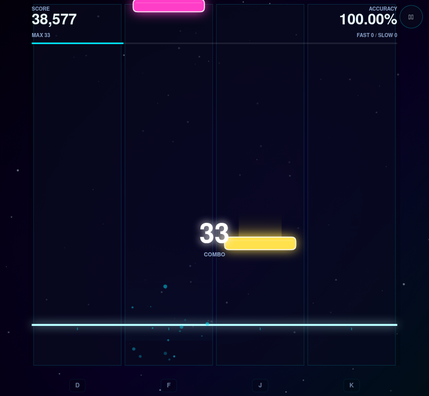

<p align="center">
  
</p>

<h1 align="center">Neon Beat</h1>

<p align="center">
  <b>单文件 4K 下落式音游</b><br />
  HTML5 Canvas + Web Audio · 零依赖 · 键盘与触屏 · 桌面与移动端打包
</p>

<p align="center">
  <a href="LICENSE"></a>
  <a href="https://github.com/LJHLRJ/neon-beat/releases"></a>
  
  
  
  
  
</p>

<p align="center">
  
  
</p>

## 简介

Neon Beat 是一个完全内联在单个 `index.html` 中的 4 轨下落式音乐游戏。没有框架、没有第三方库、没有外部字体与图片，双击文件即可游玩；同时提供 Electron 桌面打包与 Capacitor 移动端打包配置。

- 4 轨下落，默认 D / F / J / K，支持改键与多点触控
- Perfect / Good / Bad / Miss 四档判定，连击、分数、准确率与 S/A/B/C/D 评级
- Easy / Normal / Hard 三档确定性谱面，BPM 120，75 秒
- Neon / Pixel / Minimal / Prism 四套皮肤
- 程序化 120 BPM 节拍、外部 CC0 音乐、8 拍音频校准
- 暂停恢复、自动暂停、减少动态效果、最高分与数据重置

## 运行

直接双击 `index.html`，或起一个本地静态服务器（推荐，便于加载外部音乐）：

```bash
python3 -m http.server 8000
# 浏览器打开 http://localhost:8000
```

首次进入后点击页面顶部“点击启用音频”，听到提示音即表示音频已启用。

## 操作

| 操作 | 键盘 | 触屏 |
| --- | --- | --- |
| 轨道 1~4 | D / F / J / K（可改键） | 点击对应轨道 |
| 开始 | Enter / 空格 | 点击“开始游戏” |
| 暂停 | Esc / P | 右上角暂停按钮 |

设置页点击键位按钮后按下新键即可改键，Esc 取消。空格、方向键、Enter、Esc、P 为保留键。

## 判定与计分

| 判定 | 时间窗口 | 基础分 | 准确率权重 |
| --- | --- | --- | --- |
| Perfect | ≤ 45 ms | 1000 | 1.0 |
| Good | ≤ 90 ms | 700 | 0.7 |
| Bad | ≤ 120 ms | 300 | 0.3 |
| Miss | > 120 ms 或漏接 | 0 | 0 |

- 连击倍率：`1 + min(combo, 100) × 0.01`，上限 2.0
- 评级：S ≥ 95%，A ≥ 90%，B ≥ 80%，C ≥ 70%，其余 D
- 自动演示的成绩不计入最高分

## 音频

- 没有外部音乐时，使用 Web Audio 实时合成 120 BPM 节拍
- 将 `music.mp3` 放在同目录（通过 http(s) 访问）可自动加载，也可在设置页手动选择本地音频
- 切换后台或失焦会自动暂停，恢复后需手动继续
- 不同设备、蓝牙耳机的延迟不同，请在“校准”中完成一次 8 拍校准，必要时微调 `offsetMs`（±200ms）
- 使用外部音乐前请确认授权为 CC0、公共领域或明确免署名可商用；仓库不附带任何音乐文件

## 打包

桌面（Electron）：

```bash
npm install
npm start
npm run dist:win     # Windows：portable + NSIS
npm run dist:mac     # macOS：dmg，需在 macOS 上构建
npm run dist:linux   # Linux：AppImage + deb
```

产物输出到 `release/`。

移动端（Capacitor）建议使用独立目录：

```bash
mkdir -p ../neonbeat-mobile
cp index.html capacitor.config.ts ../neonbeat-mobile/
cd ../neonbeat-mobile
npm init -y
npm i @capacitor/core @capacitor/cli @capacitor/android
npx cap add android
npx cap sync android
npx cap open android
```

Android 需要 JDK 17、Android Studio、SDK 33+；iOS 需要 macOS、Xcode 15+ 与 CocoaPods。

## 数据

设置与最高分保存在浏览器 `localStorage`，统一前缀 `neonBeat.`。设置页“重置数据”需连续点击两次确认。

## 许可

[MIT](LICENSE)
